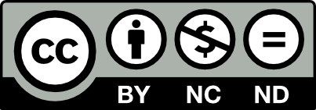

# 📚 Apunte — Apuntes, Trabajos y Guías en LaTeX

[](https://www.latex-project.org/)
[](https://www.python.org/)
[](https://www.gnu.org/software/bash/)
[](https://creativecommons.org/licenses/by-nc-nd/4.0/)

Repositorio personal y centralizado de apuntes, informes de laboratorio, proyectos de ingeniería, cheat-sheets y guías de ejercitación matemática. Los documentos están compuestos principalmente en **LaTeX** y acompañados de scripts en **Python** para generación algorítmica de ejercicios y análisis de datos.

---

## 🧭 Mapa de Navegación Rápida

| Sección / Módulo | Descripción | Temáticas y Cursos |
| :--- | :--- | :--- |
| [**`Herramientas/`**](./Herramientas/README.md) | **CC1000 — Herramientas Computacionales** | Informes técnicos (`Informes/`), laboratorios (`Labs/`), trabajos previos (`TP/`) y post-laboratorio (`TPL/`) en LaTeX, Python y Excel. |
| [**`Desafios/`**](./Desafios/README.md) | **CD1100 — Desafíos de Innovación** | Reportes de innovación, entrevistas y proyectos de ingeniería bajo estándares bibliográficos APA. |
| [**`Fisica/`**](./Fisica/) | **FI1000 — Introducción a la Física Clásica** | Material docente oficial de referencia: cátedras, clases auxiliares, laboratorios y libros guía. |
| [**`Bio/`**](./Bio/README.md) | **Biología Celular y Molecular** | Hojas de resumen condensadas (*cheat-sheets*) de alta densidad para EP1, EP2 y EP3. |
| [**`balti/`**](./balti/README.md) | **Generador Kumon Matemáticas** | Generador en Python de guías de ejercicios matemáticos (nivel F: fracciones, jerarquía de operaciones, potencias y cuadrados) con pautas resueltas. |
| [**`Prog-Comp/`**](./Prog-Comp/README.md) | **Programación Competitiva** | Apuntes selectivos para ICPC, OCI y ProgComp Uchile con snippets optimizados de C++20 y algoritmos de grafos / estructuras de datos. |
| [**`In/`**](./In/README.md) | **Instituto Nacional (Enseñanza Media)** | Apuntes de 12 asignaturas escolares: Matemáticas, Probabilidades, Cálculo, Física, Ciudadanía, Política, Filosofía, Literatura y Biología. |
| [**`Lukas/`**](./Lukas/README.md) | **Proyecto USACH** | Informe técnico, bibliografía y planos de fabricación de ingeniería mecánica. |
| [**`images/`**](./images/) | **Recursos Gráficos Comunes** | Logos, escudos y assets compartidos por múltiples módulos. |

---

## 🌳 Estructura del Repositorio

```
Apunte/
├── Herramientas/              # CC1000 (FCFM Uchile): Informes, Labs, TP, TPL
│   ├── Informes/              # Informes formales en LaTeX (plantilla Pablo Pizarro)
│   ├── Labs/                  # Laboratorios en Python, Jupyter y Excel
│   ├── TP/                    # Trabajos previos de preparación
│   ├── TPL/                   # Reportes post-laboratorio
│   └── README.md              # Documentación detallada de CC1000
│
├── Desafios/                  # CD1100 (FCFM Uchile): Innovación en ingeniería
│   ├── Reporte/               # Reporte final con bibliografía APA
│   ├── Tarea_3-1/             # Entregas de hitos del proyecto
│   ├── Tarea_4/               # Entrevistas y validaciones
│   └── README.md              # Documentación de Desafíos
│
├── Bio/                       # Resúmenes condensados de Biología
│   ├── EP1/ · EP2/ · EP3/     # Fichas compactas (Cheat-Sheets)
│   └── README.md              # Índice de materias biológicas
│
├── balti/                     # Sistema generador de guías tipo Kumon
│   ├── gen-kumon.py           # Script generador base en Python
│   ├── Fracs/ · Papomudas/    # Fracciones y jerarquía operacional
│   ├── avanzado/              # Nivel F Experto
│   ├── patas/                 # Cuadrados y cálculo mental
│   └── README.md              # Guía de uso y regeneración
│
├── Prog-Comp/                 # Programación Competitiva (C++ / STL)
│   ├── Apunte_Selectivo.tex   # Fuente en LaTeX con algoritmos y plantillas
│   ├── Apunte_Selectivo.pdf   # Documento PDF compilado
│   └── README.md              # Temario y detalles de algoritmos
│
├── In/                        # Apuntes de Enseñanza Media (Instituto Nacional)
│   ├── Mates/ · Limites/      # Álgebra, funciones y cálculo infinitesimal
│   ├── Probabilidad.../       # Conteo, muestreo y estadística
│   ├── Ciudadania/ · Filo/    # Humanidades, debate y formación ciudadana
│   ├── Cuentos lenguaje/      # Literatura y análisis de textos
│   └── README.md              # Índice general de materias escolares
│
├── Fisica/                    # FI1000: PDFs docentes de referencia (Auxiliares, Cátedras)
├── Lukas/                     # USACH: Proyecto de dibujo técnico y planos
├── images/                    # Logos institucionales y recursos visuales
├── push.sh                    # Script de sincronización y subida a Git/GitHub
├── LICENSE                    # Licencia Creative Commons (CC BY-NC-ND 4.0)
└── README.md                  # Este documento
```

---

## 🛠️ Instrucciones de Compilación y Uso

### 1. Compilación de Documentos LaTeX

Cada documento `.tex` es completamente independiente y se encuentra junto a sus recursos locales.

- **Con `latexmk` (recomendado):**
  ```bash
  cd Herramientas/Informes/Informe_03
  latexmk -pdf main.tex
  ```
- **Con `pdflatex`:**
  ```bash
  cd Bio/EP1
  pdflatex Cheat-Sheet.tex
  ```
- **Para documentos con bibliografía (Biber / BibLaTeX):**
  ```bash
  cd Desafios/Reporte
  pdflatex Reporte.tex
  biber Reporte
  pdflatex Reporte.tex
  ```

> [!TIP]
> Los archivos auxiliares temporales de compilación (`.aux`, `.log`, `.fls`, `.synctex.gz`, etc.) están filtrados por el `.gitignore` del repositorio, manteniendo el árbol de trabajo siempre limpio y enfocado en los archivos fuente y los PDFs finales.

---

### 2. Generación de Guías Kumon (`balti/`)

Las guías de matemática se crean mediante scripts en Python que resuelven las ecuaciones de manera inversa para generar problemas limpios:

```bash
cd balti/avanzado
python3 gen.py
latexmk -pdf Kumon_F_Experto_Ejercicios.tex
latexmk -pdf Kumon_F_Experto_Respuestas.tex
```

---

### 3. Sincronización Automática con GitHub (`push.sh`)

El repositorio incluye un script en Bash/Zsh para agilizar los commits y sincronizaciones remotas:

```bash
./push.sh
```
- Si no se proporcionan argumentos, añade los cambios pendientes (`git add .`), solicita un mensaje descriptivo de commit (o asigna uno automático con fecha y hora si se presiona Enter), y ejecuta `git push origin main`.
- También permite subir rutas específicas: `./push.sh Bio/EP1`.

---

## 📜 Licencia

Todo el contenido académico y apuntes de este repositorio están licenciados bajo **Creative Commons Atribución-NoComercial-SinDerivadas 4.0 Internacional (CC BY-NC-ND 4.0)**.

<p align="left">
  <a href="https://creativecommons.org/licenses/by-nc-nd/4.0/">
    
  </a>
</p>

- **Atribución:** Debes reconocer la autoría de la obra de manera adecuada.
- **No Comercial:** No puedes hacer uso del material con fines comerciales.
- **Sin Derivadas:** Si remezclas, transformas o creas a partir del material, no puedes distribuir el material modificado.

Para más información, consulta el archivo [LICENSE](./LICENSE).
